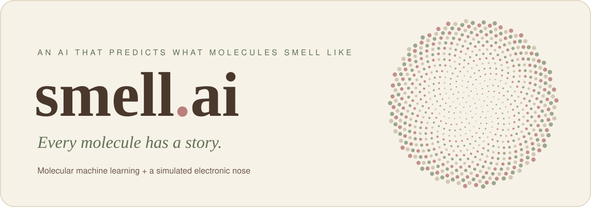
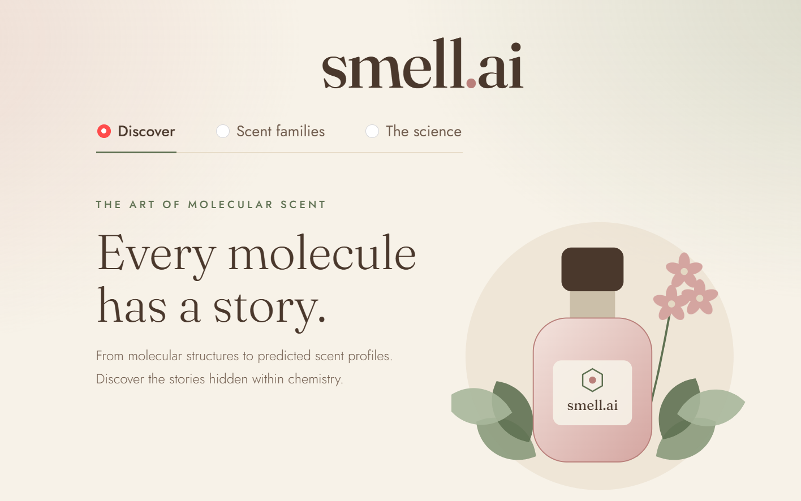
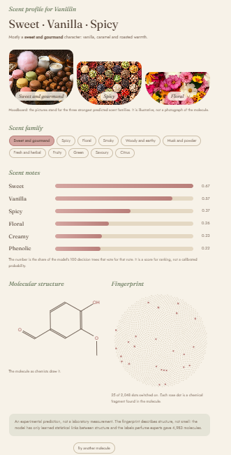
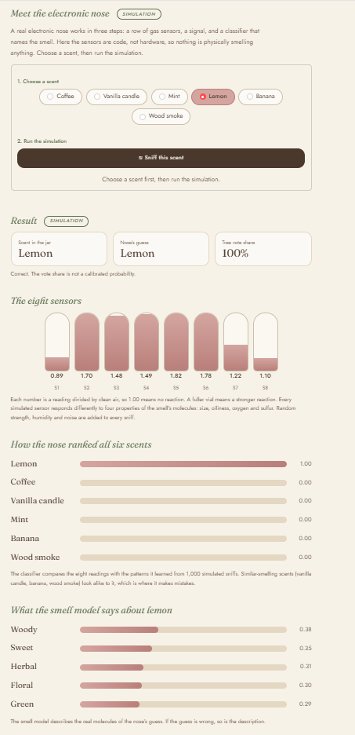
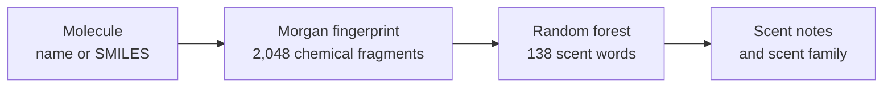
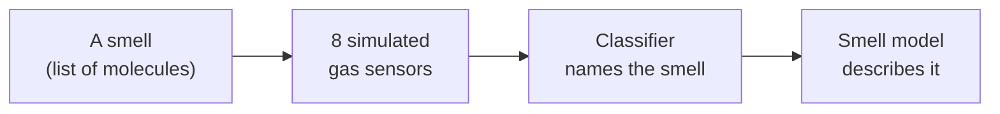

<p align="center">
  
</p>

<p align="center">
  
  
  
  
  
  
</p>

<p align="center">
  <b>Type a molecule. Get its predicted scent.</b><br>
  <sub>A machine-learning model that reads chemical structure and describes what it smells like, joined to a simulated electronic nose that tells smells apart.</sub>
</p>

<br>

<table>
  <tr>
    <td width="50%"></td>
    <td width="50%"></td>
  </tr>
</table>

<br>

## What it does

**Discover a scent.** Enter a molecule by name (`vanillin`, `limonene`, `eugenol`) or as a SMILES string. The app returns a predicted scent profile: the strongest scent words, a scent family, the chemical structure, and the molecule's fingerprint drawn as a flower.

**Scent families.** Nine families, each with example molecules you can click to explore.

**The science.** A plain-language page on how it works and how far to trust it, plus a simulated electronic nose: choose a smell, and eight virtual gas sensors react, a classifier names the smell, and the chemistry model describes it.

<p align="center">
  
</p>

## How it works



1. **Fingerprint.** RDKit reads the molecule as a graph of atoms. Every chemical fragment within two bonds of any atom switches on one of 2,048 slots.
2. **Prediction.** A random forest learned from 4,983 molecules labelled by perfume experts which fragments go with which of 138 scent words (fruity, minty, smoky, and so on).
3. **Presentation.** The strongest words become the scent notes. The 138 words are grouped into 11 scent families (grouping made for this project, not part of the dataset).

**The electronic nose** is a second pipeline:



## Results

| Model | Result | Measured on |
| --- | --- | --- |
| Smell model | **0.853** mean ROC-AUC across 138 scent words | 997 molecules hidden during training |
| Strongest words | sulfurous 0.98 (71 examples), cooling 0.97 | Same test set |
| Weakest words | musty 0.66 (47 examples), dry 0.66 (34 examples) | Same test set |
| Simulated nose | **87.1%** accuracy on six smells | 20% of simulated sniffs, hidden during training |

For ROC-AUC, 0.5 is guessing and 1.0 is perfect. The model does best on scents tied to a clear chemical feature (sulfur-containing molecules) and worst on subjective words, where experts disagree.

The nose is near-perfect on mint, lemon and coffee. It confuses vanilla candle, banana and wood smoke, whose molecules have similar size, oiliness and oxygen content, so their simulated readings overlap. Its mistakes carry over to the smell model, which then describes the wrong smell.

## What is real and what is simulated

| Real | Simulated |
| --- | --- |
| The dataset (4,983 expert-labelled molecules) | The eight gas sensors |
| Morgan fingerprints computed by RDKit | Sensor noise, humidity and strength |
| The trained random forest and its test scores | The nose's accuracy (tested on the same simulator that made its training data, so it shows the pipeline works, not how a real sensor would perform) |
| Molecule lookup through PubChem | The mixtures: each smell is a hand-picked list of 5 to 6 real aroma molecules |

## Run it yourself

Requires Python 3.10 or newer.

```bash
git clone https://github.com/YOUR-USERNAME/smell-ai.git
cd smell-ai
python -m venv .venv
.venv\Scripts\activate            # macOS/Linux: source .venv/bin/activate
pip install -r requirements.txt

python download_data.py           # downloads the 4,983-molecule dataset
python featurize.py               # molecules -> fingerprints
python train_smell_model.py       # trains the smell model (a few minutes)
python train_nose.py              # trains the simulated nose (seconds)
streamlit run app.py              # opens the app in your browser
```

Molecule names are looked up in a built-in list first, then on [PubChem](https://pubchem.ncbi.nlm.nih.gov/), so unknown names need an internet connection. SMILES strings always work offline.

## Project structure

```
smell-ai/
├── app.py                 # the Streamlit app
├── pipeline.py            # nose -> smell model, joined into one function
├── sensor.py              # the eight simulated gas sensors
├── samples.json           # six smells, each a list of real aroma molecules
├── download_data.py       # fetches the dataset
├── featurize.py           # molecules -> 2,048-slot fingerprints
├── train_smell_model.py   # trains and saves the smell model
├── train_nose.py          # trains and saves the nose
├── evaluate.py            # per-word scores for the smell model
├── make_banner.py         # draws the banner at the top of this page
├── .streamlit/config.toml # pins the light theme
└── assets/                # banner and screenshots
```

`check.py`, `fingerprint_demo.py`, `explore_data.py`, `describe.py` and `check_samples.py` are small scripts written while building each step, kept as a record of how the project grew.

## Limitations

- **Structure is not smell.** A fingerprint describes chemistry. The model learns statistical links between structure and expert labels, so it can be wrong, and some scent words are subjective.
- **Scores are not probabilities.** The numbers shown are the share of the forest's 100 trees that vote for a word. They rank options but are not calibrated.
- **The families are my own grouping** of the dataset's 138 words.
- **The nose is a simulation.** Its 87% says nothing about how a real sensor would perform.

## Roadmap

Swap the simulator for a real gas sensor (a BME688 stepped through several heater temperatures), record each smell in a jar over several sessions, and test the classifier on a session it has never seen.

## Credits

- Lee et al., *A principal odor map unifies diverse tasks in olfactory perception*, Science (2023), from Google Research, Osmo and the Monell Center.
- [OpenPOM](https://github.com/ARY2260/openpom) (MIT licence): the open rebuild of that work and the curated dataset, built on GoodScents and Leffingwell odour data. The dataset is downloaded at run time and not redistributed here.
- Built with [RDKit](https://www.rdkit.org/), [scikit-learn](https://scikit-learn.org/), [Streamlit](https://streamlit.io/) and [PubChem](https://pubchem.ncbi.nlm.nih.gov/).
- Typefaces: Fraunces and Jost, via Google Fonts.

<p align="center"><sub>smell.ai · chemistry, reimagined</sub></p>